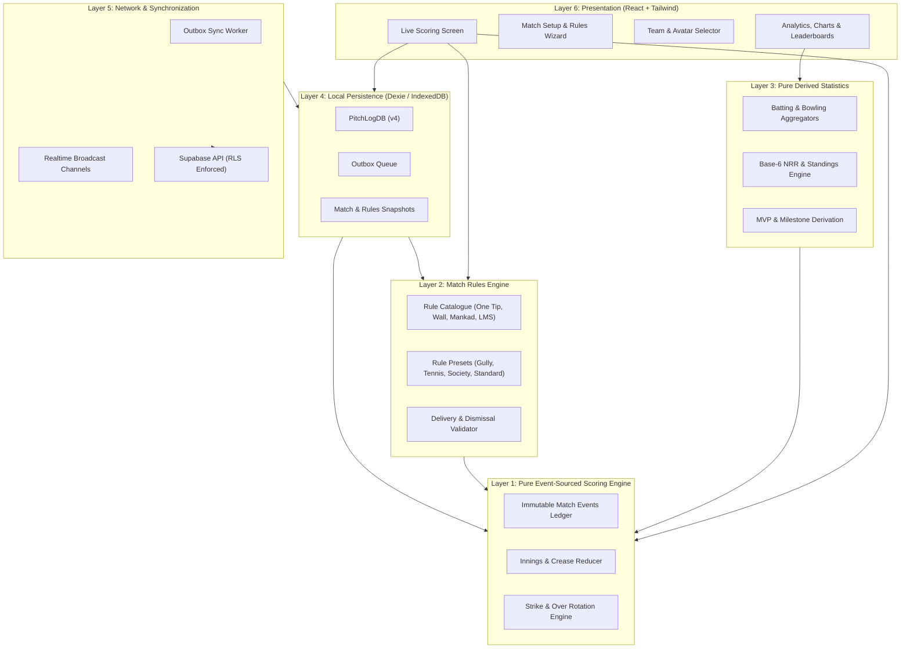
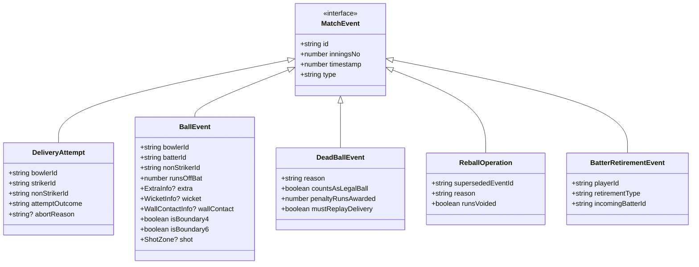
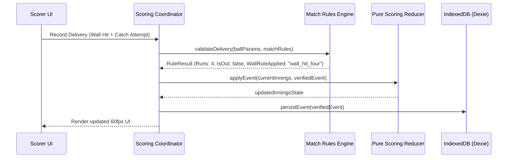
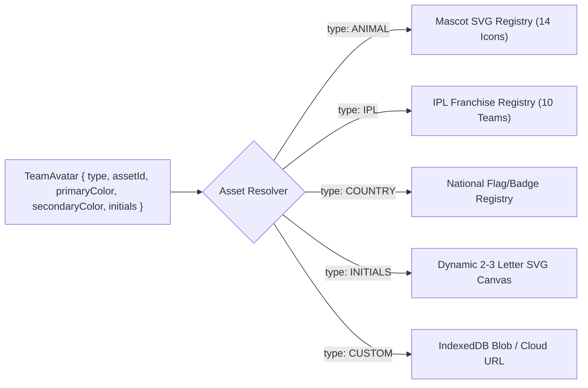
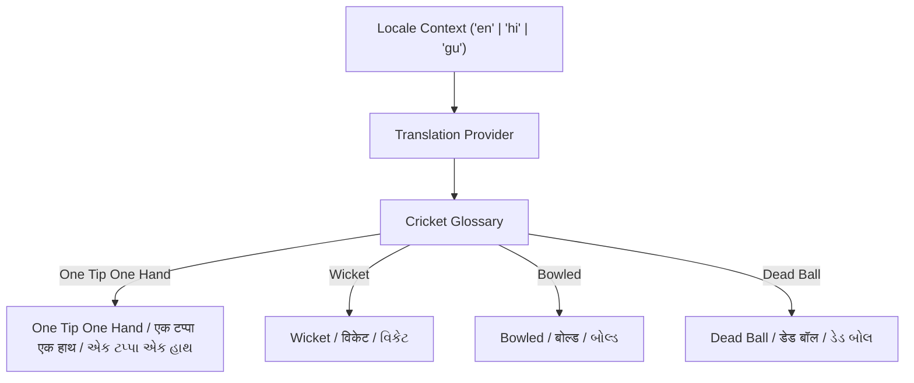

# PitchLog System Architecture & Technical Design

**Document Version:** 2.0.0  
**Status:** Approved for Implementation Planning  
**Scope:** Event-Sourced Engine, Rules Engine, Player Identity, Team Branding & Persistence  

---

## 1. System Overview & Clean Layered Architecture

PitchLog adheres to a strict hexagonal, layered architecture where the core domain logic remains 100% pure, decoupled from UI frameworks, storage engines, and cloud services.

---

## 2. Event Sourcing & Delivery Lifecycle Architecture

In standard scoring apps, match score, wickets, and overs are stored as mutable integers (`score = score + 4`). This architecture fails catastrophically in grassroots cricket where umpires reverse decisions, balls are declared dead mid-delivery, overthrows occur, or gully rules require reballs.

In PitchLog, **every action is an immutable event**. State is a pure mathematical projection:
$$\text{State}_t = f(\text{Rules}, [\text{Event}_1, \text{Event}_2, \dots, \text{Event}_t])$$

### 2.1. Explicit Event Taxonomy

To eliminate ambiguity and prevent accidental double-counting, the domain model strictly separates delivery attempts, legal balls, dead balls, reballs, and player status changes:

#### Detailed Taxonomy Definitions:
1. **`DeliveryAttempt`:** Captures an initiated delivery before completion (e.g., bowler pulls out at the crease, ball slips from hand and rolls dead, non-striker is warned).
2. **`BallEvent` (Legal / Completed Delivery):** Represents a completed delivery bowled to the batter. Encapsulates runs off bat, extras (wide, no-ball, bye, leg-bye, penalty), wicket details, wall contact outcomes, and optional wagon-wheel shot vectors.
3. **`DeadBallEvent`:** Represents an explicit halt of play (external animal/vehicle invasion, ball lost in bushes, spectator interference). Explicitly declares whether legal ball count increments, whether penalty runs apply, and whether the delivery must be re-bowled.
4. **`ReballOperation`:** Represents an operational replay mandate. It references a `supersededEventId`, marks its outcomes as voided for scoring while retaining the attempt in the audit log, and guarantees the legal delivery counter does not advance.
5. **`WicketEvent` (Embedded or Standalone):** Encapsulates dismissal details, fielder involvement, bowler credit, and crease position resolutions.
6. **`BatterRetirementEvent`:** Distinguishes voluntary retirements (`retired_hurt` vs `retired_out`). Does not charge a dismissal to the bowler.

---

## 3. Dedicated Match Rules Engine Architecture

Rather than embedding conditional `if/else` checks throughout the scoring reducer, PitchLog introduces a standalone **Match Rules Subsystem** (`src/rules/`).

### 3.1. Rules Evaluation Pipeline

### 3.2. Rule Categories & Evaluation Constraints

1. **One Tip One Hand Catch Validator:**
   - Validates that catches satisfy: $\text{bounces} \le \text{rule.maxBounces}$ and $\text{hands} = 1$.
   - Validates boundary wall contact restrictions: If ball touched boundary wall and `canTouchWallBeforeCatch === false`, dismissal is rejected and scored as runs.
2. **Mankad Run-Out Validator:**
   - Evaluates whether Mankad is permitted under active rules.
   - Requires non-striker ID and active bowler ID.
   - Never credits wicket to bowler; increments team wickets and marks batter out.
3. **Wall Boundary Outcome Engine:**
   - Evaluates ground-specific wall contact flags (`wallHit` vs `wallTap`).
   - Maps physical contact directly to rule outcomes (`four_runs`, `six_runs`, `dead_ball`, `custom_runs`, `out`).
   - Normal boundary four/six scoring runs parallel to and independent of wall scoring.
4. **Pace Call Evaluator (Pending Clarification):**
   - Architectural placeholder `PaceCallRule` is established in types.
   - Evaluator returns `status: "PENDING_SPECIFICATION"` until explicit rules are confirmed by the project lead.

---

## 4. Player Identity & Profile Architecture

### 4.1. Stable Identity Invariant
- **Rule:** A player's unique identity is represented by a permanent, immutable RFC4122 v4 UUID (`PlayerId`).
- **Name vs Identity Separation:**
  - `PlayerRecord.name` is the user's mutable current display name.
  - Matches snapshot the player's name at match creation time in `MatchRecord.teamSnapshots`.
  - Updating a player's profile name in the library propagates to future matches but preserves historical scorecards verbatim.
- **Multi-Team Association:**
  - Players are independent top-level entities stored in `players`.
  - `TeamRecord.playerIds` stores an array of foreign keys pointing to `PlayerId`.
  - A player can belong to $N$ teams simultaneously without duplicate records.

### 4.2. Player Merging Protocol
When duplicate player records are inadvertently created (e.g. "Rahul" and "Rahul Sharma"):
1. The user triggers `mergePlayers(sourcePlayerId, targetPlayerId)`.
2. All historical `BallEvent` records referencing `sourcePlayerId` (as batter, bowler, non-striker, or fielder) are remapped to `targetPlayerId`.
3. `TeamRecord.playerIds` lists are updated to deduplicate.
4. `sourcePlayerId` is marked with `deletedAt: Date.now()`.
5. An undo token with a 10-second rollback window is cached locally and enqueued to the outbox.

---

## 5. Team Branding & Avatar System Architecture

To avoid forcing users to upload image files on the field while providing rich team branding, PitchLog implements a **Vector Asset Resolution Engine**:

### 5.1. Offline Asset Bundling
- Mascot and franchise icons are compiled as inline React SVG components or standard SVG paths bundled directly into the application chunk.
- No network requests are required to render team crests on scorecards or live broadcast headers.

---

## 6. Multilingual Architecture (i18n)

PitchLog supports **English**, **Hindi (हिंदी)**, and **Gujarati (ગુજરાતી)** across all cricket terminology:

- Glossaries are partitioned into `common`, `rules`, `scoring`, `stats`, and `settings`.
- If a translation key is missing in Gujarati or Hindi, the system defaults gracefully to English without crashing.

---

## 7. Storage & Sync Architecture

### 7.1. IndexedDB Schema Evolution (Dexie v4)
- Version 4 stores:
  - `players`: `'id, name, battingStyle, bowlingStyle, deletedAt'`
  - `teams`: `'id, name, deletedAt'`
  - `matches`: `'id, date, status, updatedAt, shareToken, isLive, rulesPresetId'`
  - `matchRules`: `'id, matchId, presetName, version, createdAt'`
  - `deliveryAttempts`: `'id, matchId, inningsNo, sequence, timestamp'`
  - `ballEvents`: `'id, matchId, inningsNo, sequence, [matchId+sequence], deletedAt'`
  - `outbox`: `'id, type, entityId, matchId, createdAt, attempts'`

### 7.2. Outbox Synchronization Protocol
- All database writes are committed locally first inside an atomic Dexie transaction.
- Each mutation pushes a payload to `outbox`.
- Background `SyncWorker` dequeues batches, pushes idempotent upserts to Supabase with exponential backoff, and removes confirmed records.
- Cloud downtime or network failure never interrupts local scoring.
