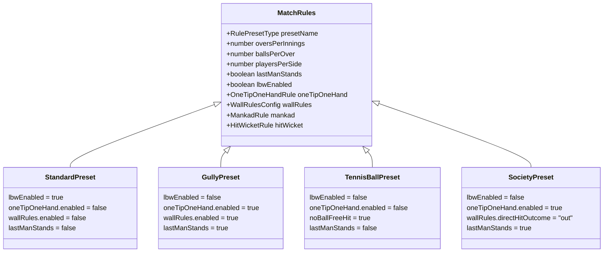

# Gully Cricket Rules Engine Specification (`docs/MATCH_RULES.md`)

**Document Version:** 2.0.0  
**Status:** Approved Specification  
**Architecture:** Pure Functional Rules Evaluator (`src/rules/`)  

---

## 1. Overview & Architectural Principles

Grassroots cricket in India is defined by hyper-local conventions adapted to restricted physical spaces (residential lanes, housing society compounds, terrace rooftops, narrow box turfs).

To honor these variations while maintaining mathematical rigor:
1. **No Hardcoded Gully Exceptions in the Core Reducer:** The core scoring engine (`src/engine/`) remains purely mathematical. All local rule interpretations are mediated by a dedicated **Rules Evaluation Layer** (`src/rules/`).
2. **First-Class Rule Presets:** Scorers can choose from 5 standardized presets or configure custom parameters.
3. **Immutable Rule Versioning:** Every match captures an immutable snapshot of its `MatchRules` at the moment of toss confirmation. Historical match scores and rule applications never change if presets are later updated.

---

## 2. Complete Rule Catalogue

### 2.1. One Tip One Hand ("एक टप्पा एक हाथ")
In residential gullies with narrow boundaries, fielders often cannot catch high-velocity hits cleanly on the full without risk of injury or colliding with parked vehicles. The "One Tip One Hand" rule balances the contest between batter and bowler.

- **Trigger Condition:** A fielder catches the ball after it has bounced off the ground.
- **Rule Parameters:**
  - `enabled: boolean` — Toggles the rule active for the match.
  - `maxBounces: number` — Maximum allowable ground bounces prior to the catch (Default: `1`).
  - `maxHandsAllowed: number` — Maximum hands permitted to secure the catch (Default: `1`). If a fielder uses two hands or cups the ball against their body, the catch is **invalid** and play continues as a live ball.
  - `canTouchWallBeforeCatch: boolean` — If `true`, a catch remains valid if the ball bounced and also struck a boundary wall before being caught. If `false` (standard gully convention), touching any wall deadens the catch and renders it runs or dead ball.
  - `bowlerCredited: boolean` — Default is `true`. The wicket is credited to the active bowler as a caught dismissal.
- **Scorecard Representation:**
  - Displayed as: `c <Fielder> (1-tip) b <Bowler>` (Hindi: `कैच <Fielder> (एक टप्पा) बोल्ड <Bowler>`).

---

### 2.2. Mankad (Non-Striker Run Out Prior to Release)
- **Context:** A non-striker stealing ground before the bowler's front foot lands or arm releases.
- **Rule Parameters:**
  - `enabled: boolean` — Default is `true` in competitive/standard presets; configurable in informal gully play.
  - `bowlerCredited: boolean` — Always `false`. Per MCC Law 38, this is an official run-out, not credited to the bowler's bowling figures.
  - `recordingMethod`: Recorded as a standard `runout` dismissal with `runOutSubtype: 'mankad'`, identifying the active bowler and the dismissed non-striker.
- **Validation Constraints:**
  - Only the non-striker can be dismissed via Mankad.
  - Does not advance the legal balls count of the over.
  - No deliveries were legally bowled; runs off bat remain 0.

---

### 2.3. Hit Wicket
- **Context:** A batter dislodges their own stumps/bails with their bat, person, helmet, or apparel while playing a stroke or setting off for their first run.
- **Rule Parameters:**
  - `enabled: boolean` — Default `true`.
  - `bowlerCredited: boolean` — Default `true`. Credited to the active bowler.
  - `freeHitExemption: boolean` — Default `true`. In accordance with MCC Law 21.18, a batter **cannot** be dismissed Hit Wicket off a Free Hit delivery.

---

### 2.4. Wall & Boundary Rules
- **Context:** Gully grounds are bordered by boundary walls, garage shutters, compound grills, or parked vehicles.
- **Outcome Matrix:**

| Contact Type | Configurable Outcome Options | Default in Gully Preset | Default in Society Preset |
| :--- | :--- | :--- | :--- |
| **Direct Wall Hit (Air)** | `four_runs` \| `six_runs` \| `dead_ball` \| `out` \| `custom_runs (1..12)` | `four_runs` | `out` (Broken glass rule) |
| **Wall Tap / Ground Touch** | `one_run` \| `dead_ball` \| `boundary_four` \| `no_effect` (live ball) | `one_run` | `dead_ball` |
| **Direct Window / Vehicle Hit** | `out` \| `out_and_minus_runs (-5)` \| `dead_ball` | `out` | `out_and_minus_runs (-5)` |
| **Catch Rebound off Wall** | `allowed` \| `not_allowed` (dead ball or runs) | `not_allowed` | `not_allowed` |

- **Independence:** Wall boundary rules operate in parallel with standard boundary markers. A match can have standard 4s and 6s on open sides, and wall rules on restricted sides.

---

### 2.5. Pace Call (Local Street Rule)
> [!IMPORTANT]
> **Status: PENDING CLARIFICATION**  
> The exact operational rule for "Pace Call" varies across Indian localities (e.g. speed restrictions for adult bowlers against junior batters, spinners bowling medium pace, or umpire calls on over-speeding in small gullies).  
> **Architecture Policy:** PitchLog defines the schema placeholder `PaceCallRule { enabled: boolean; status: 'PENDING_SPECIFICATION' }`. The scoring engine will not make assumptions or hardcode behaviors until explicit specifications are provided by the project lead.

---

### 2.6. Dead Ball Management
- **Manual Trigger:** The scorer or umpire can declare a dead ball at any point before or during delivery resolution.
- **Standardized Reason Codes:**
  - `animal_on_pitch`: Dog, cat, cow, or bird crossing the pitch.
  - `passerby_interference`: Vehicle, cyclist, pedestrian, or resident passing through the lane.
  - `ball_lost`: Ball hit into drain, over high terrace wall, or under a parked vehicle.
  - `player_injured`: Batter or bowler slips on concrete or sustains an injury mid-delivery.
  - `gear_breakage`: Broken tennis ball, bat handle split, or shoe blowout.
  - `umpire_call`: Umpire halts play due to sightline distraction or bowler not calling guard.
- **Accounting & Rules Resolution:**
  - `countsAsLegalBall: boolean` — Default is `false` (does not increment the over's legal ball counter).
  - `runsAwarded: number` — Default is `0`. If penalty runs apply (e.g., ball hits fielder's helmet or unauthorized object), runs can be awarded.
  - `mustReplayDelivery: boolean` — Default is `true`. Triggers a fresh delivery attempt.

---

### 2.7. Reball (Replayed Delivery Operations)
- **Concept:** Distinct from an "Undo" (which corrects a human scoring error). A Reball represents an actual on-field mandate to re-bowl a delivery attempt.
- **Strict Invariants:**
  1. **Zero Run Duplication:** Runs scored on an aborted or re-bowled delivery are nullified.
  2. **Legal Counter Invariance:** An aborted delivery never increments the legal delivery counter of the over.
  3. **Audit Preservation:** The aborted attempt is preserved in the database as a `DeliveryAttempt` with outcome `reball_demanded` for complete historical traceability.
  4. **Subsequent Delivery Link:** The fresh delivery references `supersededAttemptId`.

---

### 2.8. Additional Configurable Rule Options

| Rule Parameter | Configuration Range | Gully Preset Default | Standard Cricket Default |
| :--- | :--- | :--- | :--- |
| **LBW (Leg Before Wicket)** | `enabled: boolean` | `false` ("Gully me LBW nahi hota") | `true` |
| **Last Man Standing (LMS)** | `enabled: boolean` | `true` (Lone batter continues) | `false` ($N-1$ wickets = All Out) |
| **Balls Per Over** | `4, 5, 6, 8, 10` | `6` (or `4`/`5` in quick matches) | `6` |
| **Wide Re-bowl** | `enabled: boolean` | `true` (or `false` for quick 2-over street games) | `true` |
| **Wide Runs Awarded** | `1, 2, 3` | `1` | `1` |
| **No-Ball Re-bowl** | `enabled: boolean` | `true` | `true` |
| **No-Ball Free Hit** | `enabled: boolean` | `false` (or `true` on turf) | `true` |
| **Byes Allowed** | `enabled: boolean` | `true` | `true` |
| **Leg-Byes Allowed** | `enabled: boolean` | `false` | `true` |
| **Overthrows Allowed** | `enabled: boolean` | `false` (Dead ball upon throw) | `true` |
| **Wickets Per Innings** | `1 .. 11` | `playersPerSide` | `playersPerSide - 1` |

---

## 3. Rule Presets Catalogue



---

## 4. Pure Validator Functions (`src/rules/validator.ts`)

The rules layer exposes pure, testable validator functions:

```typescript
/** Validates whether a catch satisfies the active One Tip One Hand rules */
export function validateOneTipCatch(
  bounces: number,
  hands: number,
  touchedWall: boolean,
  rule: OneTipOneHandRule,
): { isValid: boolean; reason?: string };

/** Validates whether a Mankad dismissal is legal under current match rules */
export function validateMankadDismissal(
  dismissedPlayerId: string,
  nonStrikerId: string,
  rule: MankadRule,
): { isValid: boolean; reason?: string };

/** Resolves wall contact outcome based on active wall configuration */
export function evaluateWallContactOutcome(
  contactType: 'direct_hit' | 'ground_tap' | 'window_hit',
  wallRules: WallRulesConfig,
): { runs: number; isOut: boolean; isDeadBall: boolean };

/** Determines whether a bowler is permitted to bowl another over under quota */
export function canBowlerBowlNextOver(
  bowlerId: string,
  oversBowled: number,
  maxOversPerBowler: number,
  previousOverBowlerId: string | null,
): { allowed: boolean; reason?: string };
```
